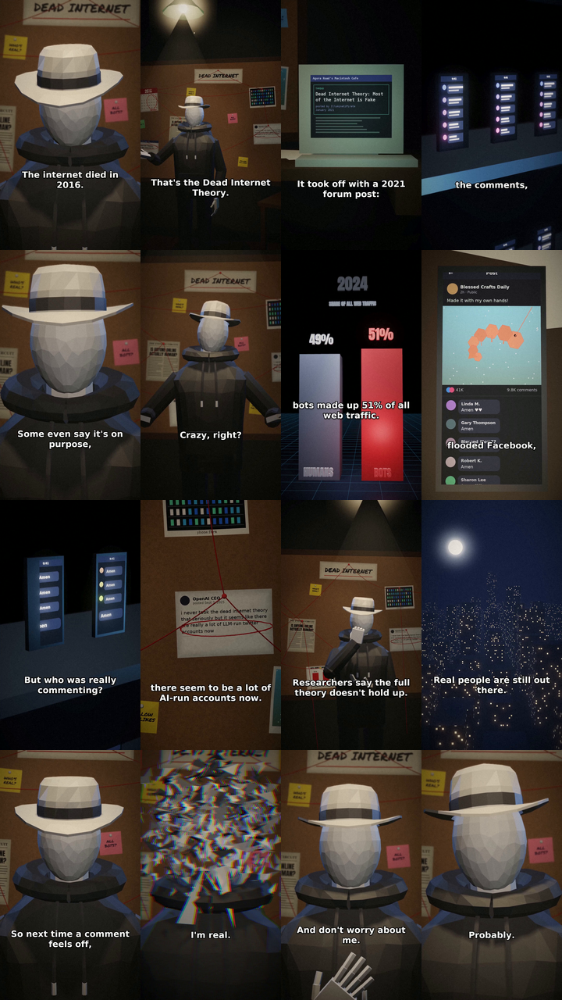

# dead-internet-theory

The complete code behind "The Internet Died in 2016… and Nobody Noticed" (Story Time with Kenji, Nov 2026; 67.38 s, 2,021 frames, 1080×1920, 30 fps). It's a 3D low-poly conspiracy-theory Short about the Dead Internet Theory.
- **Story:** a faceless hooded man in a fedora explains the theory in a dark room with an evidence board. It cuts to a phone farm, a 3D bar chart and a night city. The twist ending shatters his head into facets: "I'm real." … "Probably."
- **3D throughout:** rendered with `../../shared/lowpoly-gl` at about 1 s a frame on 2 cores. On the same machine, Blender 5.3's EEVEE and Cycles took 41–44 s a frame on a simpler test scene.
- **The channel's sound and text:** the voice is `../storytime-narrator` (am_michael), the music is `../storytime-music` with a new E minor preset, and the captions come from `../storytime-kit`.



**Used in:** The Dead Internet Theory, Story Time with Kenji, Nov 2026 (delivered as `dead_internet.mp4`).
- **Render time:** 31 min for the 2,021 frames (0.93 s a frame) on a 2-core cloud session, then about 1 min for the final encode.
- **Verified from this folder:**
  - `build_all.py` rebuilt all 78 mesh parts and 17 textures, identical to the delivered ones
  - `make_video.py narrate` gave a byte-identical `narration.wav` and `timeline.json`
  - `make_audio.py` gave a byte-identical `mix.wav` (−14.9 LUFS)
  - `make_video.py render who debunk` gave scene files byte-identical to the delivered `s08.mp4` and `s10.mp4`
- **Not re-run from this folder:** the other 12 scenes and `final`.
- **Since then:** `../../shared/lowpoly-gl` stopped its additive pass from writing depth (Nov 28, 2026). Re-rendered frames now differ from the delivered ones where dust motes sat behind the lamp's beam cone: 0.7% of the hook frame's pixels. The `who` and `city` frames tested were identical.

## Files
- `story.py`: the 33 caption lines, as (scene, caption[, spoken text]).
- `layout.py`: where everything sits. The room is at the origin; the farm, chart stage and city are far away. It also holds the board items, pins and strings, the lamp and the desk.
- `textures.py`: the board papers, sticky notes, the CRT forum post, the phone-screen atlas and the scrolling "Amen" post, all drawn with Pillow.
- `build_sets.py`: the sets: the room (cork board, papers, pins, hanging lamp, desk, CRT, phone), the phone farm (840 phones), the chart stage (3D text in Anton) and the city.
- `build_all.py`: textures, then `../hooded-man`, then the sets, into `build/assets.npz` (needs bpy).
- `shots.py`: one function per scene (14 scenes), plus the room lights, dust, red strings (which droop on "doesn't hold up"), and the head glitch.
- `make_video.py`:
  - `narrate`, `stills t…`, `render [scene…]`, `final`, `all`, `preview`
  - The settings at the top hold `GLITCH_PAUSE`, `REMAP`, the cut dip, the end fade and the encoder.
- `make_audio.py`: the E minor organ preset, the effect cues, a synthesized digital-glitch effect, and the mix at −14 LUFS.
- `thumb.py`: three no-text thumbnail candidates; the shattering head (`b`) is the pick.
- `banner.py`: the 2560×1440 channel banner, with the man at his board and the title "CONSPIRACY THEORIES / explained by a man with no face" kept inside YouTube's 1546×423 safe area. It also writes a preview of the TV, desktop and phone crops. `BANNER_TITLE` (lines split by `|`) and `BANNER_SUB` change the text, for example to add the channel's new name. Since the depth-mask fix in `../../shared/lowpoly-gl`, more dust shows at the top edge than in the delivered banner (0.5% of pixels, outside the safe area).
- `get_fonts.py`: Special Elite, Permanent Marker and Anton from google/fonts at a pinned commit, SHA-256 checked.
- `paths.py`: puts the sibling props on `sys.path`.
- `style.json`: the episode's facts: timing, scenes, lights, music, cues and sources.

## Reuse
```bash
./setup.sh kids-songs --bpy                 # from the repo root
cd kids-songs/dead-internet-theory
python3 get_fonts.py
python3 build_all.py                        # textures + meshes -> build/assets.npz, about 2 s
python3 make_video.py narrate               # build/voice/, about 2.3 min
python3 make_video.py stills 2 31 64        # full-size stills -> build/stills/, build/stills_sheet.png
python3 make_audio.py                       # build/mix.wav
python3 make_video.py render                # build/scenes/s00.mp4 ... s13.mp4, about 31 min on 2 cores
python3 make_video.py final                 # build/dead_internet.mp4 (BT.709, tagged, CRF 21, about 110 MB)
python3 make_video.py preview               # redraws preview.png from the finished video
python3 thumb.py                            # build/thumb_a.png, thumb_b.png, thumb_c.png
python3 banner.py                           # build/banner/channel_banner.png, .jpg, preview.png
```
- **A new episode in this format:** copy the folder, then:
  - rewrite `story.py`, keeping pieces of 2–7 words
  - re-map lines to shots in `REMAP`
  - redraw the board items in `textures.py` and place them in `layout.py`
  - rewrite the scene functions in `shots.py` and the cues in `make_audio.py`
- **Re-rendering:** `render chart` or `render 6` renders one scene again. A plain `render` skips scene files that exist.
- **Look first:** `stills` draws full-size frames in about 1.2 s each.

## Gotchas
- **The glitch pause:** "I'm real." and "Probably." needed 0.9 s more between them for the head to shatter. `GLITCH_PAUSE` splices that silence into the narration and shifts the timeline; the narrator itself doesn't add it.
- **`REMAP`:** lines 5, 22, 26 and 27 play in different shots from the scene names in `story.py`, because the shots split and merge the script's scenes.
- **No real brands on props:** the clipping's masthead is invented ("The Evening Circuit"). The first draft used "The Daily Signal", which is a real outlet.
- **Phone screens all showed one cell** until the `cellf`, `tt` and `rate` uniforms were actually set. A dropped uniform fails silently.
- **Dust near the camera** turned into huge bright blobs in close-ups. Motes within about 1 m of the camera now fade out.
- **Narrow frame:** in close-ups a hand at arm's length is outside the portrait frame. "Ask yourself who wrote it" became a temple tap, and the reveal's hat tip became a small shrug.
- **His face:** the lamp's brim shadow hid the top half of the face, so a narrow spot from in front (`FACE_KEY` = 1.4 in `shots.py`, 13° cone) lights it. It's narrow enough to stay off the board.
- **Exposure:** the lamp is a 1.55-energy spot about 1 m above his head. Above about 2.5 the black hoodie reads grey and the hat blows out.
- **Caption heights** are set per scene in `shots.SCENES`. The chart uses y = 1230 so the HUMANS / BOTS labels stay visible.
- **Facts** were checked on Nov 28, 2026; see `style.json`. The script frames the theory as a theory and says researchers don't support the full version.

## What it can't do
- No lip sync (he has no face) and no walking.
- Each set is far from the others, so there are no camera moves between them, only cuts.
- No reflections or global illumination; the sets are lit by hand with spot and point lights.

## Dependencies (tested)
- Python 3.13.18, bpy 5.3.0 (assets only), moderngl 5.13.0 on Mesa 25.2.8 llvmpipe, numpy 2.5.3, opencv-python-headless 5.0.0.93, pillow 12.3.0, skia-python 144.1, scipy 1.18.1, soundfile 0.14.0, kokoro-onnx 0.6.1 with onnxruntime 1.29.0
- ffmpeg 6.1.1 with libx264 and the `loudnorm` filter
- Fonts from `get_fonts.py` (Apache 2.0 and SIL OFL 1.1), plus DejaVu from `../storytime-kit/get_fonts.py`
