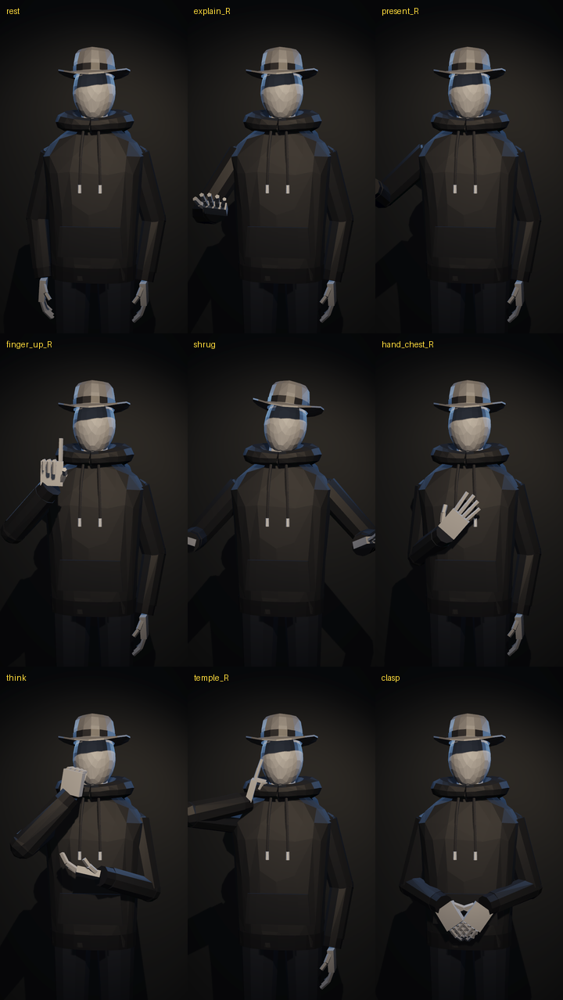

# hooded-man

The low-poly hooded man from The Dead Internet Theory: a faceless faceted mannequin head, a grey fedora with a dark band, a black hoodie with the hood down around his neck and two drawstrings, sleeves, and grey mannequin hands. It's built with numpy and Blender's Decimate (bpy 5.3) and rendered with `../../shared/lowpoly-gl`.
- **Rig:** rigid parts on pivots (hips and head), two-bone IK arms with a pole vector, and four hand poses (relax, open, point, fist).
- **Gestures:** 14 named poses in `poses.py`, among them explain, present, finger up, shrug, hand on chest, think, temple tap and clasped hands.
- **Motion:** a keyframe track with eased blends, breathing, sway and small head motion, speech nods from a loudness envelope, and a facet-explode glitch for the head and hat.



**Used in:** every shot with the man in The Dead Internet Theory (Story Time with Kenji, Nov 2026, `../dead-internet-theory`).
- **Verified:** `pose_sheet.py` rebuilt the 26 parts (4,527 triangles) from this folder, byte-identical to the man in the episode's `assets.npz`, and drew `preview.png`.

## Files
- `rig.py`: the rest pose (hip, head and shoulder pivots, arm lengths), the colours, and the hand poses as finger curl angles.
- `build_man.py`:
  - `build()` adds every part to `meshkit.PARTS`, each in the local frame of the node it hangs from
  - `python3 build_man.py` writes `out/man.npz`
  - The settings at the top hold the head resolution and decimation, the skull size, and the hat tilt and position.
- `man.py`:
  - `items(pose)` returns `(mesh, matrix, material)` for the renderer
  - `track(keys, t)` blends keyed poses; `add_life(pose, t, env)` adds breathing, sway and speech nods
  - `explode(part, amount)` scatters a part's facets
  - `REST`, `ik()`, `blend()`, `merge()`
- `poses.py`: `G`, the named gestures.
- `pose_sheet.py`: builds the man, renders nine gestures, and with `--preview` redraws `preview.png`.
- `style.json`: proportions, colours, and the rig conventions.

## Reuse
```bash
python3 pose_sheet.py              # needs bpy==5.3.0 and moderngl -> out/man.npz, out/pose_sheet.png
python3 build_man.py               # just the meshes -> out/man.npz
```
```python
import sys; sys.path[:0] = ['props/kids-songs/hooded-man', 'props/shared/lowpoly-gl']
import man, meshkit
from poses import G
r.add_meshes(meshkit.load('out/man.npz'))                 # r: a lowpoly-gl Renderer
keys = [(0.0, dict(head=(15, 0, 0))),                     # head down
        (1.2, dict(G['shrug'], dur=0.35)),                # shrug 1.2 s in
        (2.5, dict(G['finger_up_R'], L=man.REST['L']))]  # one finger up; left arm back down
pose = man.add_life(man.track(keys, t), t, env=0.0)
items = man.items(pose)                                   # + your set's items -> r.render(...)
```
- **A pose** is `root=(x, y, z, yaw_deg)`, `lean=(pitch, roll)`, `head=(pitch, yaw, roll)`, and per arm `R` / `L` = `dict(w=wrist, f=finger direction, p=palm direction, g=hand pose, pole=offset)`.
  - Wrists are in torso space: the origin is the hips pivot, and the shoulders sit about 0.42 m up.
  - He faces -Y, and his right arm is at -X (screen left).
  - Head pitch > 0 looks down; yaw > 0 turns to his left (screen right).
- **Glitch:** `explode(parts['head'], a)` for each name in `man.HEAD_PARTS`, then `renderer.set_dynamic(name + '_x', ...)` and `items(pose, glitch_head={name: name + '_x'})`.

## Gotchas
- **His face (GJ's notes on the first version):**
  - Eye-socket dents and a brow ridge rendered as dark, slanted facets under the brim, which read as an angry frown.
  - A 15 cm-wide skull under the wide brim and the big hood ring read as a really small face.
  - The head is now 17.6 cm wide, with a fuller jaw and a slightly higher hat.
  - A long nose ridge with a rounded tip read as phallic in close-ups. The face is now blank (`NOSE = 'none'`). A short triangular `'wedge'` nose is still available, but it sat low and looked like a mouth.
  - Keep the face plain, and light it from the front (the episode's `FACE_KEY` spot) so the brim shadow doesn't hide its top half.
- **Portrait frames are narrow.** At 1.2 m with a 30° lens, the frame is only about 0.36 m wide. A hand held out at arm's length leaves it, so keep gestures near the body's centre line for close shots.
- **Pointing straight at the camera** reads as a claw, because the finger is foreshortened. The episode switched that beat to a temple tap.
- **The hat brim shadows the face** when the key light is more than about 45° above it. That's the noir look; a weak front fill keeps the facets readable.
- **The hood ring hides the neck.** Lowering `HEAD` more than about a centimetre buries the chin in it.
- **Hands swap meshes** halfway through a blend. There is no finger animation between the four poses.
- **Leans over about 10°** show the rigid torso crossing the legs at the waist.

## What it can't do
- No skinning or walking: the parts are rigid and the legs are static.
- No face, so no lip sync. Speech shows as head nods.
- Fingers only take the four poses in `rig.HAND_POSES`.

## Dependencies (tested)
- Python 3.13.18, bpy 5.3.0 (Decimate), numpy 2.5.3, pillow 12.3.0
- `../../shared/lowpoly-gl` (moderngl 5.13.0, opencv-python-headless 5.0.0.93)
