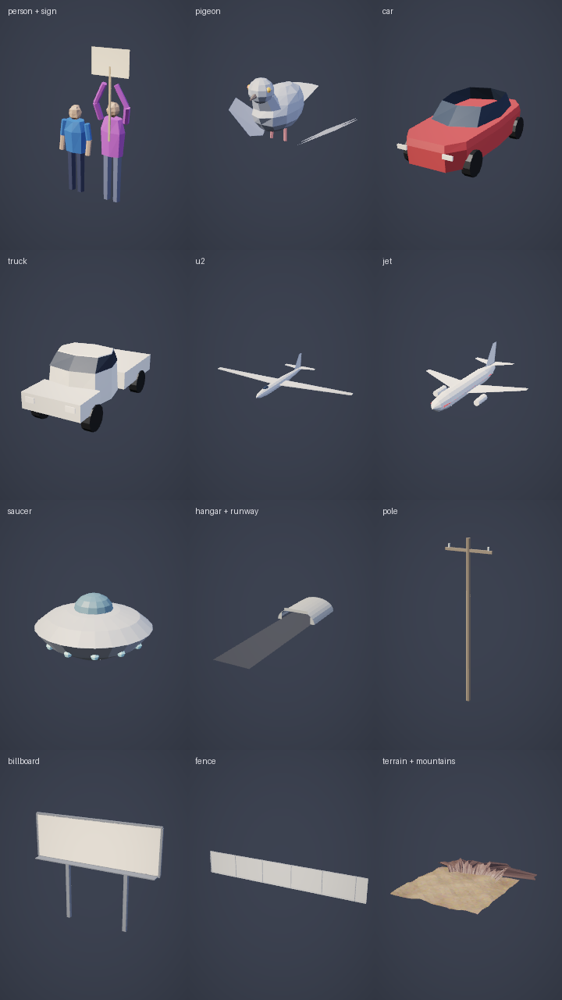

# lowpoly-sets

Reusable low-poly set pieces for the 3D Story Time with Kenji episodes, built with numpy and `../../shared/lowpoly-gl/meshkit.py` and rendered with `../../shared/lowpoly-gl`. They are a protester with an optional placard, a pigeon with separate wings and a robot-eye LED, a hatchback, a pickup, the U-2, a small airliner, a flying saucer, an arched hangar with a runway, a utility pole, a billboard, a fence, faceted desert terrain and a ring of mountain ridges.



**Used in:** Area 51 and Birds Aren't Real (Story Time with Kenji, Nov 2026; `../area-51`, `../birds-arent-real`).
- **Area 51:** the terrain (with a flattened disc at the gate), the mountain ridges, the runway, hangars, U-2, airliner, saucers, guard truck, fence and protesters.
- **Birds Aren't Real:** the pigeons (perched, flying and on his hat), the car, poles, billboard, placards and both crowds.
- **Verified:** `preview.py` drew `preview.png` from this folder without Blender. Both episodes built their assets from this file.

## Files
- `sets.py`: one function per piece. Each returns meshkit meshes in local coordinates (metres, Z up, the front faces -Y), or a dict of parts. The docstring at the top lists them.
  - `person(seed, arms_up)`: about 1.7 m; returns (mesh, per-face colours). With `arms_up` the hands are at about z = 2.0, for a sign held overhead.
  - `sign(w, h, pole)`: a placard board (UVs 0..1, for a texture) and a stick.
  - `pigeon()`: body, beak, legs, eyes, `led` (over the right eye) and `wing_L` / `wing_R`. `WING_PIVOT` holds the shoulder pivots, for `meshkit.add(..., pivot=...)`.
  - `car()`, `truck()`: body, glass, wheels and lights parts.
  - `sky_dome(cols)`: an inverted sphere with per-face gradient colours. The episodes use a per-vertex version instead (see Gotchas).
  - `terrain(size, n, amp, seed, flat_r, cols, flats)`: a faceted ground grid with height colours. `flat_r` flattens a disc at the origin, and `flats=[(x, y, r)]` flattens more.
  - `mountains(radius, n, h, seed, arc, depth)`: one continuous skyline of `n` points around a ring or an arc, with a faceted front slope and a back slope.
  - `hangar(w, d)`, `runway(length, width)`, `u2()`, `jet()`, `saucer(r)`, `pole(h)`, `billboard(w, h, z)`, `fence(length, h)`.
- `preview.py`: draws every piece on one 3×4 sheet, `preview.png`.
- `style.json`: sizes, colours and pivots.

## Reuse
```bash
python3 preview.py                          # preview.png, about 1 s
```
```python
import sys; sys.path.insert(0, 'props/kids-songs/lowpoly-sets')
import sets as S
from meshkit import add                     # sets.py puts ../../shared/lowpoly-gl on sys.path
p, cols = S.person(7, arms_up=True)
add('protester', p, cols)
pg = S.pigeon()
add('pg_body', pg['body'], (0.46, 0.49, 0.56))
add('pg_wing_L', pg['wing_L'], (0.36, 0.38, 0.45), pivot=S.WING_PIVOT['wing_L'])   # rotate about the shoulder
```
- **Flapping:** draw a wing with `M @ T(WING_PIVOT[w]) @ R3(euler(0, -side * angle, 0))`, where side is +1 for `wing_L` and -1 for `wing_R`. `shots.flap_angle` in `../birds-arent-real` gives 7 beats a second.
- **A perched pigeon** needs no wings; the body covers them.
- **A robot pigeon:** `../birds-arent-real/build_sets.py` recolours the body in metal bands and lights the `led` part with `emit`.

## Gotchas
- **Smooth skies:** `sky_dome` colours each face, which shows facets in a sunset. The episodes write a per-vertex gradient straight into `meshkit.PARTS` (`add_smooth_sky` in their `build_sets.py`) and draw it with material mode 5 (unlit vertex colour).
- **Mountains:** the first version was one cone per segment, which read as a row of teeth. They are now one continuous ridge with five sine octaves, and each crest sits back from its foot by 1.5× its height.
- **Terrain under a set:** the desert's noise made a mound under the Area 51 gate. `flats=((x, y, r),)` flattens a disc there.
- **The fence panel** is a plane meant for a see-through texture: chain link with alpha, drawn with `tmode=3` (`fence_tex` in `../area-51/textures.py`). Without one it draws solid, as in the preview.
- **People have no faces or hands,** to match the faceless hooded man.

## What it can't do
- No skinning or walk cycles: people only bob, turn and hold signs.
- No textures of their own. Signs, billboards and fences take textures you draw, such as `../birds-arent-real/textures.py`.
- Pieces are sized for the portrait 1080×1920 episodes. The planes and saucers are simplified and unmarked, with no real logos.

## Dependencies (tested)
- Python 3.13.18, numpy 2.5.3, moderngl 5.13.0 on Mesa 25.2.8 llvmpipe (preview only), pillow 12.3.0, opencv-python-headless 5.0.0.93 (post pass)
