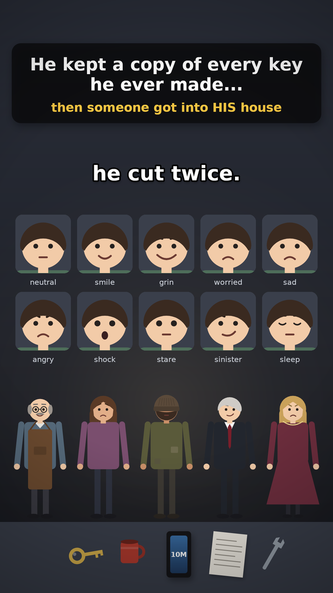

# storytime-kit

The flat 2D look of the Story Time with Kenji Shorts, drawn with skia-python at 1080×1920 and 30 fps. It has:
- **Characters:** the rig `person()`, with 7 hair styles, 10 expressions, stand, walk and sit poses, bendable arms and a held prop.
- **Props and sets:** small props (key, mug, phone, paper, book, wrench) and set pieces (window, framed picture, lamp, couch, coffee table, house, tree, car, fog).
- **On-screen text:** the caption and hook-card style.
- **Renderer:** an episode is a table of scene functions plus the narration timeline from `../storytime-narrator`. `render()` turns them into one H.264 file per scene, and `concat_and_mux()` joins them and adds the soundtrack from `../storytime-music`.



**Used in:** The Locksmith and The Hero (Story Time with Kenji, Nov 2026).
- **Videos:** I rebuilt both from this repo (`../the-locksmith`, `../the-hero`). Every scene's H.264 stream had the same checksum as in the delivered videos. The one exception is the scene in The Hero that this repo fixes (see Gotchas).
- **Fonts:** with the fonts from `get_fonts.py`, 39 test frames per episode came out pixel-identical to frames drawn with Ubuntu's DejaVu package, which the videos used.

## Files
- `storytime_kit.py`: the module. The settings at the top hold the canvas, caption and hook-card sizes, the hook and fade timings, the encoder flags and the font search path. `python storytime_kit.py` redraws `preview.png`.
- `get_fonts.py`: installs the seven DejaVu 2.37 fonts the kit loads. It downloads the GitHub release zip, falling back to npm, and skips any that are already installed. `--local` puts them in `fonts/` here.
- `style.json`: the look as values: sizes, colours, timings, character options.
- `preview.png`: the hook card, a caption, the ten expressions, five character looks from the episodes, and the props.

## Reuse
Run this from a work folder next to your clone:
```python
import sys; sys.path.insert(0, "props/kids-songs/storytime-kit")   # path to this folder
from storytime_kit import *

GUY = dict(skin=SKIN['mid'], hair='short', hair_col='#3A2A20', top='#4E6E5A', pants='#2F3340')

def kitchen(c, t, x):          # t: seconds into the scene; x.T / x.E: each line's start / end in the scene
    grect(c, -500, 0, W + 1000, H, ['#9A8F7E', '#6E6558'])    # wider than the frame, for the camera
    rect(c, -500, 1500, W + 1000, 500, '#4A3A2E')
    seen = ramp(t, x.T[1], 0.3)                               # 0 -> 1 as the second line starts
    person(c, 540, 1560, 1.4, GUY, expr='shock' if seen > 0.5 else 'neutral', t=t,
           arms=(6, (-40, 160)), hold=lambda cc: mug(cc, 0, 0, 0.8))

SCENES = {'kitchen': dict(draw=kitchen, cam=(1.0, 1.08, 540, 1200), cap_y=760)}
tl = {'duration': 4.0, 'hook': ['He made coffee every morning...', 'until the mug was already full'],
      'lines': [{'scene': 'kitchen', 'text': 'He made coffee.', 'start': 0.2, 'end': 1.4},
                {'scene': 'kitchen', 'text': 'The mug was warm.', 'start': 1.8, 'end': 3.2}]}
contact_sheet(tl, SCENES, 'out/stills.png', cols=1)   # look at a frame first: no encoding
render(tl, SCENES, 'out/scenes')                       # out/scenes/s00.mp4 ... + list.txt
```
- **Scenes:** each scene is `dict(draw=fn, cam=..., cap_y=..., vig=...)`.
  - `draw(c, t, x)` gets the canvas in 1080×1920 coordinates, the seconds since the scene started, and `x`. `x.T` and `x.E` hold each line's start and end within the scene, and `x.dur` its length.
  - `ramp(t, x.T[i], 0.3)` goes from 0 to 1 as line i starts.
  - A real timeline comes from `../storytime-narrator`. Every line's scene must be in `SCENES`.
- **Camera:**
  - `cam=(zoom_from, zoom_to, focus_x, focus_y)` eases the zoom over the scene.
  - For pans, use a function `(t, x) -> (zoom, fx, fy)` or `(zoom, fx, fy, screen_x, screen_y)`. The focus point is held at the screen point.
- **`person(c, x, y, s, look, ...)`:**
  - **Size:** the feet are at (x, y), and a figure is about 510·s px tall.
  - **Pose:** `mode` is `'stand'`, `'walk'` (with `phase`) or `'sit'`.
  - **Arms:** `arms=(screen-left, screen-right)`. Each arm is an angle in degrees from straight down, where positive swings away from the body. An (upper, forearm) pair bends the elbow.
  - **Props:** `hold(c)` draws in the screen-right hand.
  - **Face:** `expr` sets the expression, and `look` turns the eyes, from −1 to 1.
  - **Other options:** `back=True` turns the figure around, `rot` tilts it, and `wet=True` adds drips.
- **Seating someone on a couch:** draw `couch(..., part='back')`, then `person(x, couch_y - 100, ..., mode='sit', legs=False)`, then `couch(..., part='front')`.
- **Joining and sound:** `concat_and_mux(scenes_dir, wav, mp4)` joins the scene files with `-c copy` and adds the audio as AAC 192k without re-encoding the picture.
- **New episode:** copy `../the-locksmith` and replace its `story.py` and `scenes.py`. Its `build.py` does narration, music, picture and mux in one command.

## Gotchas
- **Draw wider than the frame.** A zoom-out or a pan shows past the 1080 px edges.
  - Scenes with moving cameras draw their backgrounds from about −500 to W+500, and floors down to H+500.
  - Without that, black bands showed in The Hero's pans and in The Locksmith's Morrison scene.
- **The hook card covers y≈140–400 for the first 3.7 s.** Keep the first scene's signs and faces below it.
- **Captions are 66 px bold and wrap at 960 px.** Keep a caption to about six words, and set each scene's `cap_y` clear of faces. The episodes use 330–1720.
- **Missing glyphs.** DejaVu Serif (regular, bold and italic) has no ✓, though the sans fonts do.
  - The delivered The Hero shows empty boxes in the schedule note of its reveal scene. That scene's file here draws the ticks as paths, so its rebuilt scene 11 differs from the upload.
  - Before encoding, check every string a new episode draws against the font it uses.
- **Look at stills before encoding.** `contact_sheet()` draws one frame per scene in about 2 s. `render(tl, scenes, None, frames_at=[...])` returns any frames as arrays.
- **Timing comes from the narration.**
  - A scene starts halfway through the pause before its first line, and a caption appears 0.05 s before its line is spoken.
  - If you change the words, re-run the narrator and the scenes stretch with them.
- **Speed:** on a 2-core cloud session, the episodes rendered at 14–21 frames a second, so the picture of an 80 s episode takes 2–3 minutes.

## What it can't do
- **Animation:** no lip sync, hand-drawn animation or physics. Characters move by pose, walk cycle, blinking and expression changes, and scenes move with the camera.
- **Transitions:** only a 0.2 s dip from black at each cut, plus a 0.9 s fade at the end. No crossfades.
- **Draft renders:** it draws at full size only. There's no half-size draft mode; stills are the quick check.
- **Fonts:** one type family, DejaVu.

## Dependencies (tested)
- Python 3.13.18
- skia-python 144.1 (`pip install skia-python==144.1`), numpy 2.5.3, pillow 12.3.0
- ffmpeg 6.1.1 with libx264 and the built-in AAC encoder
- DejaVu 2.37 (`python get_fonts.py`). The npm fallback needs Node/npm.
- The reference renders were made on Linux x86-64. On another OS or CPU, skia's anti-aliasing can differ by a pixel level.

No photos or third-party images are used; everything is drawn from code.
