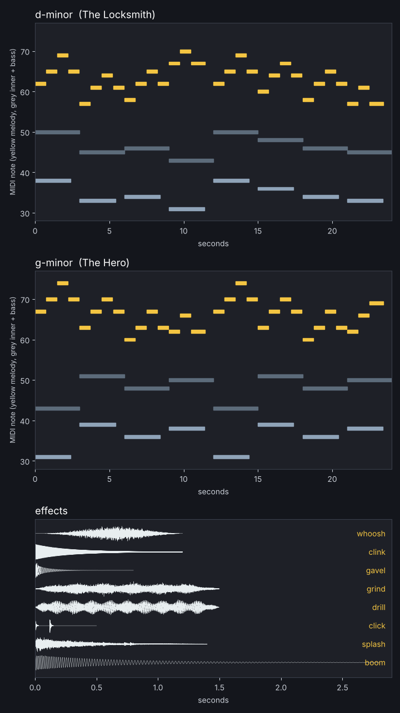

# storytime-music

The Story Time with Kenji soundtrack, synthesized with numpy and scipy from no samples.
- **Melody:** one slow, legato organ line playing root, 3rd, 5th, 3rd on each chord at 0.75 s a note.
- **Under it:** a long bass note and a quiet held inner note, 3 s per chord, in an 8-chord minor loop that starts on the first frame.
- **Organ sound:** three sine partials at 1 : 0.30 : 0.10, so the 2nd harmonic sits 10.5 dB and the 3rd 20 dB under the fundamental. That matches the channel's earlier uploads.
- **Effects:** eight synthesized sounds, cued to caption lines: boom, splash, click, drill, grind, gavel, clink and whoosh.
- **Finish:** a stereo noise reverb and a −14 LUFS loudness pass.



**Used in:** The Locksmith (preset `d-minor`) and The Hero (preset `g-minor`), Story Time with Kenji, Nov 2026.
- **The Locksmith:** its mix rebuilt from this repo is byte-identical to the shipped `mix.wav`.
- **The Hero:** its shipped mix was made in the same process right after The Locksmith's, so its effect noise came from further along the random generator. Before `mix()` was changed to restart the generator, mixing both episodes in one process in that order reproduced both shipped mixes byte for byte.
- **Rebuilding The Hero now:** it's mixed on its own, so it has the same narration and music but a different draw of effect noise. That makes its final mix differ slightly from the upload.
- **Music level:** in both delivered videos, the music measured about 5.9 dB under the voice.

## Files
- `music.py`:
  - **Settings at the top:** the two chord presets, organ partials, layer levels, reverb amounts, opening boom, peak and loudness targets.
  - **Functions:** `music(dur, preset)`, `sfx(kind, dur)` and `mix(...)`.
  - **CLI:** auditions the music or one effect, or redraws `preview.png`.
- `style.json`: every value: the music, the levels, the effects list and the master chain.
- `preview.png`: piano rolls of both presets (melody in yellow, inner note and bass in grey) and the eight effects as waveforms.

## Reuse
```bash
python music.py --preset d-minor --dur 24    # out/music_d-minor.wav: the music alone, peak-normalised
python music.py --sfx splash                 # out/sfx_splash.wav
python music.py --preview                    # redraws preview.png
```
```python
import sys; sys.path.insert(0, "props/kids-songs/storytime-music")
from music import mix
mix('out/narration.wav', 'out/timeline.json', 'out/mix.wav', preset='d-minor', music_db=-3.5,
    events=[('street', 3, 0.2, 'click', 0.7),             # 0.2 s after the street scene's 4th line starts
            ('cutting', 0, -0.1, 'grind', 0.1, 'scene')])  # a grind under the whole cutting scene
```
- **Inputs:** the narration and timeline come from `../storytime-narrator`.
- **`music_db`:** the music's RMS against the narration's RMS while it speaks. The Locksmith used −3.5 dB and The Hero −4.1 dB.
- **An event** is `(scene, line index within that scene, offset in seconds from that line's start, kind, gain[, length])`.
  - Every episode also gets a boom at 0.7 on frame 0, under the hook card.
  - The optional length is in seconds for drill and grind (defaults 1.5 s and 3 s). `'scene'` fills the scene, from 0.1 s after its cut to 0.1 s before the next one.
- **A new key or progression:** add a preset to `PRESETS`. Each chord is (bass MIDI note, inner MIDI note, four melody notes). A `None` lets the note before it ring on. The first two presets are Dm A B♭ Gm | Dm C B♭ A, and Gm E♭ Cm D, played twice.

## Gotchas
- **Versions GJ turned down before this one:**
  - a static chord pad, which he said sounded like a hum
  - a 0.5 s arpeggio, which was too fast
  - slow ringing notes, held chords and a staggered organ chorale, which weren't the same tone as his originals
  - The version that shipped is a single sustained organ line moving every 0.75 s. It's modelled on the root, 3rd, 5th, 3rd pattern he hummed.
- **No fade-in:** the music starts at full level on the first frame. The first mix faded the music in over 1.5 s, quietly and mostly in the bass. GJ's note was that his originals' music "comes in really fast".
- **Phone speakers:** they barely play the bass notes' 49–78 Hz fundamentals, so on phones the melody (220–590 Hz) carries the music. Don't lower `LAYERS['melody']` to make room for the bass.
- **Fixed noise draws:** effects use noise from one generator that every `mix()` restarts at `SEED`. A rebuild is identical, but changing the cue list changes the noise of the cues after it.
- **Loudness:** voice, music and effects are summed, peak-normalised to 0.89, and then brought to −14 LUFS by ffmpeg's one-pass `loudnorm`. Effect gains are relative to the voice before that. A loud cue that becomes the peak scales the whole mix down before the loudness pass.

## What it can't do
- **No real instruments, drums or chords that change mid-bar.** It's one organ timbre in three layers.
- **No ducking:** the music doesn't dip under the voice. The level is set once for the whole episode.
- **Fixed tempo:** chords don't follow scene cuts. They change every 3 s from the first frame.

## Dependencies (tested)
- Python 3.13.18
- numpy 2.5.3, scipy 1.18.1, soundfile 0.14.0; matplotlib 3.11.2 for `--preview`
- ffmpeg 6.1.1 (the `loudnorm` filter)

Every sound is synthesized here; no samples or third-party audio.
