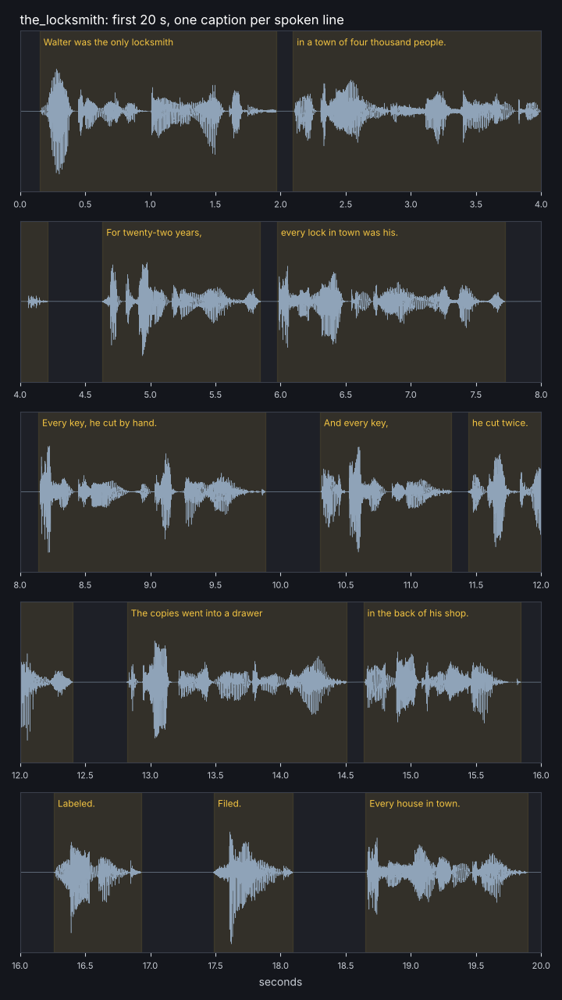

# storytime-narrator

The Story Time with Kenji voice: a calm American male narrator made offline with Kokoro v1.0 (int8 ONNX), using the voice am_michael at speed 1.0.
- **One line per caption:** every caption is spoken on its own, trimmed, and laid end to end with pauses that follow its punctuation. That gives the channel's clipped, one-caption-at-a-time delivery.
- **Output:** one narration WAV and a timeline JSON. `../storytime-kit` renders from the timeline, and `../storytime-music` mixes against both.



**Used in:** The Locksmith (46 lines, 77.76 s) and The Hero (47 lines, 81.96 s), Story Time with Kenji, Nov 2026.
- **Verified:** I re-ran both scripts from this repo with no line cache, using the model from `get_models.py`. Both gave narration WAVs byte-identical to the shipped ones, and identical timelines.

## Files
- `narrate.py`: the CLI, plus `narrate(story, out_dir)`, `speak()` and `preview()`. The settings at the top hold the voice, speed, language, model file names, pause lengths and trim threshold.
- `get_models.py`: downloads `kokoro-v1.0.int8.onnx` (92 MB) and `voices-v1.0.bin` (28 MB) into `models/` from the kokoro-onnx GitHub release `model-files-v1.0`, and checks their SHA-256.
- `style.json`: the voice, pauses and line handling.
- `preview.png`: the first 20 s of The Locksmith's narration, with each spoken line and its caption marked.

## Reuse
```bash
pip install kokoro-onnx soundfile numpy
python get_models.py                                   # once; or set KOKORO_DIR to a folder with both files
python narrate.py --say "He never stole a thing."      # audition one line -> out/say.wav
python narrate.py ../the-locksmith/story.py            # -> out/the_locksmith/narration.wav, timeline.json, lines/
python narrate.py ../the-locksmith/story.py --preview  # same, and redraws preview.png
```
- **In code:** `from narrate import narrate; tl = narrate(STORY, 'out')`.
- **Story format:** a story is `dict(name=..., hook=(white line, yellow line), lines=[...])`. Each line is `(scene, caption)`, or `(scene, caption, spoken text)` when the narrator should say something different from what's shown.
- **Timeline format:** `timeline.json` holds `duration`, `hook`, `name`, and for each line `i, scene, text, start, end` in seconds. The narration starts after 0.15 s of silence.

**Writing for this voice:**
- **Caption-sized pieces:** break sentences into pieces of 2–7 words. A piece that doesn't end in punctuation gets a comma added for Kokoro and a 0.13 s pause, so it runs on into the next caption ("He'd wait for a family to leave for work," / "and let himself in.").
- **Short sentences:** these get the longest pauses, 0.56 s after one or two words, and they carry the dread: "Labeled." "Filed." "Of him." "Asleep."
- **Other pauses:** 0.42 s after other sentences, 0.6 s after "...", and 1.8 s after the last line, for the fade-out.
- **Length:** both episodes ran 78–82 s with 46–47 lines.

## Gotchas
- **Line cache:** spoken lines are cached in `<out>/lines/` under a hash of the text and voice settings. Edit a caption and only that line is spoken again. Delete the folder to start clean.
- **Not the Wildlore model:** the int8 model isn't the fp32 model used by the Wildlore narrator (`../../animal-docs/wildlore-narrator`). They're separate downloads and sound slightly different.
- **Spoken text:** The Hero's first line gives "five a.m." as its spoken text for the caption "5 a.m.". Kokoro 0.6.1 turns both into the same phonemes, so check with `--say` before adding spoken text for the same reason.
- **Curly quotes** are removed before speaking, because Kokoro's phonemizer passes them straight through into the phonemes. The caption keeps them on screen.
- **Tight trims:** the trim keeps only 15 ms around each line's sound, so the pauses come entirely from the gap rules above.
- **Speed:** speaking a whole 46-line episode took about 2.5 minutes on a 2-core cloud session.

## What it can't do
- **One voice:** no emphasis, whispering or emotion control beyond punctuation.
- **No word timing:** captions are whole lines, so each one appears all at once.
- **English only as tuned:** other Kokoro voices and languages work through `VOICE` and `LANG`, but they haven't been tried for this channel.

## Dependencies (tested)
- Python 3.13.18
- kokoro-onnx 0.6.1 with onnxruntime 1.29.0, numpy 2.5.3, soundfile 0.14.0; matplotlib 3.11.2 for `--preview`
- Kokoro v1.0 int8 model files (Apache-2.0), downloaded by `get_models.py` and not stored in the repo
- On this machine the int8 model gave identical samples on every run. Other CPUs or onnxruntime versions may differ slightly.
