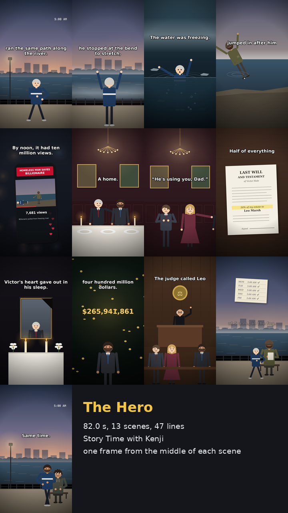

# the-hero

The complete code behind The Hero (Story Time with Kenji, Nov 2026; 81.93 s, 2458 frames, 1080×1920, 30 fps).

Every morning at 5 a.m., billionaire Victor Hale runs the same path along the river. One foggy morning the railing at the bend gives way, and a homeless man named Leo jumps in and drags him out.
- The rescue goes viral, and Victor gives Leo a job, a home and a seat at his table, then rewrites his will.
- Fourteen months later Victor dies in his sleep. Leo inherits four hundred million dollars, and the family loses in court.
- But nobody asked why Leo was waiting at that bend, or who loosened the railing the night before.
- Now Leo runs the same path, and a young man on the bench is watching.



**Used in:** The Hero. Running `python build.py` from this repo rebuilt the delivered video:
- **Picture:** 12 of the 13 scenes have the same H.264 stream checksum. Scene 11 (reveal) differs on purpose: the delivered video shows empty boxes where the schedule note's ticks should be (DejaVu Serif has no ✓), and this repo draws them as paths.
- **Narration:** byte-identical.
- **Mix:** same narration and music, but a different random draw of effect noise. The shipped mix was made right after The Locksmith's in the same process; see `../storytime-music`.

## Files
- `story.py`: `TITLE`, the hook, and the 47 lines as (scene, caption[, spoken text]). It also holds the music preset and level, and the sound-effect cues.
- `scenes.py`: one draw function per scene, the camera functions, and the `SCENES` table.
  - **Character looks:** `VICTOR`, `VICTOR_SUIT`, `LEO_POOR`, `LEO_RICH`, `LEO_JOG`, `SON`, `DAUGHTER`, `JUDGE` and `YOUNG`.
  - **Shared sets:** the river, fog, railing and path, reused across scenes and lit for dawn or night.
- `build.py`: runs narration, then mix, then picture, then the mp4. Options: `--stills`, `--frames`, `--only` and `--audio-only`. It's the same file as in `../the-locksmith`.
- `style.json`: the episode's facts: hook, length, scenes, music and cues.
- `preview.png`: one frame from the middle of each of the 13 scenes.

## Reuse
Run `../../setup.sh kids-songs` once per session. Then:
```bash
cd kids-songs/the-hero
python build.py --stills       # speaks the lines (about 2.5 min the first time), then out/stills.png
python build.py                # out/the_hero.mp4, 2.5–3 more minutes on 2 cores
python build.py --only 11      # re-render the reveal scene only, then re-join
```
To make a new episode, follow the steps in `../the-locksmith/README.md`. This one is the better template for outdoor scenes, money and news graphics (the viral phone screen, the counting inheritance), and a twist told through objects (the will, the schedule note, the wrench).

## Gotchas
- **`--only` counts scenes in screen order from 0:** jog 0, railing 1, water 2, rescue 3, viral 4, mansion 5, kids 6, will 7, funeral 8, inherit 9, court 10, reveal 11, present 12.
- **Camera moves need wide sets.** The river sets are drawn from −500 to W+500. The kids and present scenes use five-value cameras: zoom, focus x and y, then the screen point the focus is held at. Without both, the pans showed black bands.
- **Spoken text:** the first line has spoken text ("five a.m.") for its caption "5 a.m."; the later lines don't. Kokoro reads both the same way (see `../storytime-narrator`).
- **Fixes already in `scenes.py` (keep them in a copy):**
  - The judge stands with his feet at y=1300, so he shows above the bench.
  - Victor lies on the bank rotated 90° at x=110, so he stays in frame.
  - The young man sits on the bench from the start of the last scene, and only looks at the camera on the last line.

## What it can't do
- It's one finished story. Its scenes are specific drawings, so a new story needs new draw functions. The characters, sets and pipeline carry over.
- The river is flat shapes. There's no fluid simulation.

## Dependencies (tested)
- `../storytime-kit`, `../storytime-narrator` and `../storytime-music`, imported by path, so keep the `kids-songs/` layout.
- Python 3.13.18, skia-python 144.1, numpy 2.5.3, scipy 1.18.1, soundfile 0.14.0, pillow 12.3.0, kokoro-onnx 0.6.1 with onnxruntime 1.29.0
- ffmpeg 6.1.1 with libx264 and the built-in AAC encoder
- DejaVu 2.37 fonts and the Kokoro v1.0 int8 model, both fetched by `setup.sh` and not stored in the repo

Everything on screen is drawn from code and every sound is synthesized. No photos or third-party assets are used.
