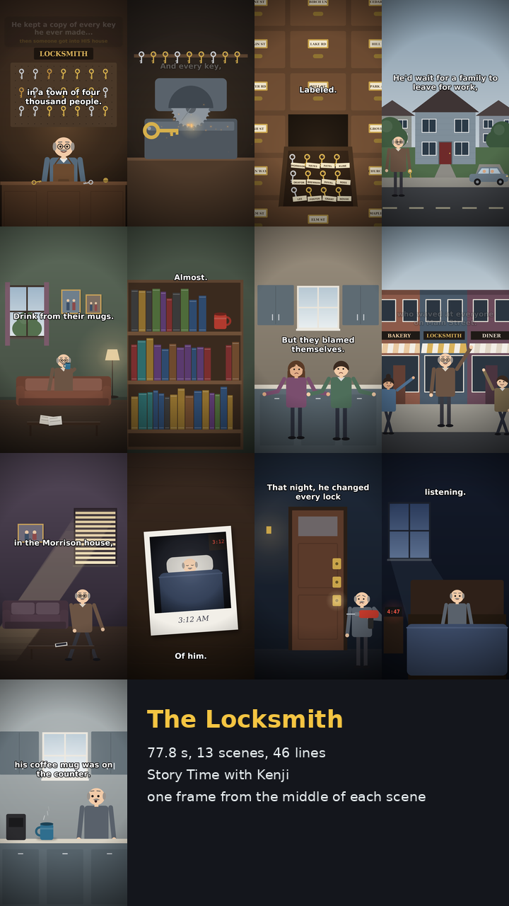

# the-locksmith

The complete code behind The Locksmith (Story Time with Kenji, Nov 2026; 77.73 s, 2332 frames, 1080×1920, 30 fps).

Walter is the only locksmith in a town of four thousand. He cuts a second copy of every key and files the copies in a drawer. He lets himself into people's houses while they're at work, then puts everything back, almost. Then, on the Morrisons' coffee table, he finds a photo of himself asleep in his own bed. He changes every lock, twice. In the morning his mug is on the counter, turned the wrong way.



**Used in:** The Locksmith. Running `python build.py` from this repo rebuilt the delivered video:
- **Picture:** bit for bit. All 13 scenes have the same H.264 stream checksum.
- **Soundtrack:** sample for sample, with the same `mix.wav`. The AAC track decodes to the same samples, except that the delivered file's track stops 44 ms earlier.

## Files
- `story.py`: `TITLE`, the hook, and the 46 lines as (scene, caption[, spoken text]). It also holds the music preset and level, and the sound-effect cues.
- `scenes.py`: one draw function per scene, the camera functions, and the `SCENES` table (draw, camera, caption height). The character looks are `WALTER`, `WALTER_OUT`, `WALTER_NIGHT`, `WOMAN` and `MAN`.
- `build.py`: runs narration, then mix, then picture, then the mp4. Options: `--stills`, `--frames`, `--only` and `--audio-only`. It's the same file as in `../the-hero`.
- `style.json`: the episode's facts: hook, length, scenes, music and cues.
- `preview.png`: one frame from the middle of each of the 13 scenes.

## Reuse
Run `../../setup.sh kids-songs` once per session for the packages, fonts and narrator model. Then:
```bash
cd kids-songs/the-locksmith
python build.py --stills       # speaks the lines (about 2.5 min the first time), then out/stills.png
python build.py --frames 31.5  # out/frame_31.50.png at full size
python build.py                # out/the_locksmith.mp4, about 2 more minutes on 2 cores
python build.py --only 9       # after editing one scene: re-render scene 9 (photo) only, then re-join
```
**Make a new episode from this one:**
1. Copy this folder next to it (for example `kids-songs/the-next-one/`), so that `build.py` still finds `../storytime-*`.
2. In `story.py`, write `TITLE`, `STORY` (name, hook, lines) and the `EVENTS` cues. Pick a `MUSIC` preset (`d-minor` or `g-minor`), or add a preset in `../storytime-music`.
3. Run `python build.py --audio-only` to hear the pacing in `out/mix.wav`.
4. Write `scenes.py`, with one draw function per scene name, and check it with `--stills` and `--frames`.
5. Run `python build.py` for the full video.

**How this story is put together:**
- **Hook card:** a white line ending in "..." and a yellow line that turns it around ("then someone got into HIS house").
- **The habit:** short, factual setup lines lead to it, stated flatly ("He never stole a thing." / "That was never the point."). Small, specific details show it (a mug turned the wrong way, a book one shelf lower).
- **The ending:** the reversal comes next. The last line repeats one of those details ("Turned the wrong way.").

## Gotchas
- **`--only` counts scenes in screen order from 0:** shop 0, cutting 1, drawer 2, street 3, living 4, putback 5, couple 6, mainst 7, morrison 8, photo 9, locks 10, awake 11, mug 12. It reuses the other scenes' files in `out/scenes/`. If you changed any words, render everything again, because every scene's timing moves.
- **Cues count lines within their scene.** Adding a line before a cue in the same scene moves the cue.
- **Fixes already in `scenes.py` (keep them in a copy):**
  - The shop sign sits at y=440, below the hook card.
  - Walter is drawn large in the shop (scale 1.7).
  - Walter sits on the couch with `legs=False`, drawn between the couch's back and front.
  - The shrug is bent arms, not a flex.
  - The drill is pistol-shaped so it reads at phone size.
  - The Morrison floor is drawn down to H+500, so the zoom shows no black band.
  - In the last scene Walter stands closer (scale 1.4, feet at y=1650), so more than his head is in frame.

## What it can't do
- It's one finished story. Its scenes are specific drawings, so a new story needs new draw functions. Only the characters, props, sets and the pipeline carry over.
- There's no lip sync or character acting beyond poses, expressions and the camera (see `../storytime-kit`).

## Dependencies (tested)
- `../storytime-kit`, `../storytime-narrator` and `../storytime-music`, imported by path, so keep the `kids-songs/` layout.
- Python 3.13.18, skia-python 144.1, numpy 2.5.3, scipy 1.18.1, soundfile 0.14.0, pillow 12.3.0, kokoro-onnx 0.6.1 with onnxruntime 1.29.0
- ffmpeg 6.1.1 with libx264 and the built-in AAC encoder
- DejaVu 2.37 fonts and the Kokoro v1.0 int8 model, both fetched by `setup.sh` and not stored in the repo

Everything on screen is drawn from code and every sound is synthesized. No photos or third-party assets are used.
