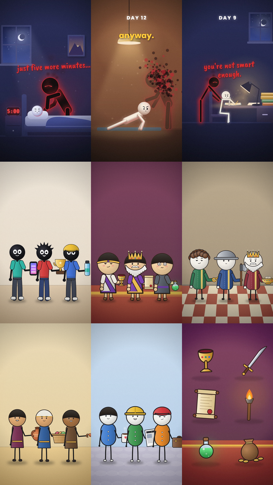

# cartoon-shorts

One engine for narrated, captioned vertical cartoon Shorts (1080×1920, 30 fps) in seven looks: the motivational white bean and stick figure, and five cartoon looks with six props each.
- the **lit** white bean person and the **stick** figure of the motivational Shorts, drawn with skia-python
- five cartoon looks: **what-if**, **palace**, **castle**, **desert** and **pill**, each with six props

It makes the voices offline (Kokoro, through `../../kids-songs/storytime-narrator`) and times the captions to the speech. Music and sound effects are synthesized. `check_lines.py` runs every spoken line through offline speech recognition (`../narration-check`).



The preview shows:
- **Top row:** 5 MORE MINUTES. in the lit look (twice, with the shadow's red handwriting, a DAY counter and gold captions), then in the stick look.
- **Middle and bottom rows:** the lineups of the what-if, palace, castle, desert and pill reels, then the palace prop sheet.

**Used in:** a motivational-Shorts test channel (Nov 2026), and as a style board for new channels.
- **Six motivational Shorts in the lit look:**

  | Short | Length | Scenes |
  |---|---|---|
  | 5 MORE MINUTES. | 57.07 s | 12 |
  | ONE MORE VIDEO. | 47.14 s | |
  | WHEN I'M READY. | 44.04 s | |
  | TWO PATHS. | 30.91 s | split screen |
  | 1% BETTER. | 26.61 s | curves |
  | FUTURE YOU. | 39.09 s | an old-man voice |

  All six rendered at 1080×1920, 30 fps, H.264 + AAC. `check_lines.py --mp4` heard all 86 spoken lines (narrator, shadow, old man) right on the finished files.
- **5 MORE MINUTES. with `--style stick`:** 57.07 s, rendered in 142 s. Every line was heard right.
- **Five look reels** (`look_whatif` … `look_pill`): 14.33 s each, no narration, about 37 s each to render. The four caption looks were drawn in test frames over a `story` line.

Re-run from a fresh clone before committing:
- `make_short.py --stills` for all eleven episodes and for `five_more_minutes --style stick`.
- Full renders of 1% BETTER. (lit and stick), `look_castle` and `look_desert` matched the delivered files frame for frame and sample for sample. The voices were spoken again from scratch.
- `check_lines.py` passed on a fresh mix, on the stick mp4 and with `--try`.
- The blob demo (`build.py`, 17.17 s, 40 s to render) matched its earlier render exactly.

## Files
- `make_short.py`: the CLI. It builds `episodes/<name>.py`.
  - `--style lit|stick` picks the motivational person.
  - `--stills`, `--frames t,t`, `--only k,k` for checks and partial re-renders.
- `motivation.py`: the engine.
  - timeline and voices (`timeline`, `voice_tracks`, a cache in `build/voice-cache`)
  - caption looks (`gold`, `punch`, `outline`, `karaoke`), the DAY counter, `hud`, `bubble`, `thought`
  - the motivational `score` and the looping `music_bed`, synth instruments and sound effects
  - the lit sets: rooms, beds, desks, lamps, windows, skylines, ridges, a tear-off calendar and more
  - `build`
- `humanoid.py`: the lit bean person and the stick figure on one rig (`use_style`), and the poses (`stand`, `walk(p)`, `run(p)`, `sit`, `kneel`, `arms_up`, …). Also the red-rimmed shadow, its smoke and its break-up.
- `cast.py`: the five cartoon looks on the same rig and poses.
  - `person(c, x, ground, s, look, pose, view, outfit, expr, gaze, hold, …)`
  - `head(…)` for close-ups
  - outfits: tops, hair (bowl, curly, spiky, head cloth), hats (crown, headband, helmet, cap, hard hat), beards
  - 11 expressions
- `cast_props.py`: 30 props, 6 per look, each drawn in its look's outline and shading. Flames, steam, bubbles, bobbing and pouring are animated by `t`. `KITS` lists them.
- `showcase.py`: the look reels: a lineup, one action with props, the prop sheet.
- `check_lines.py`: the speech check. It works on a fresh soundtrack, a finished mp4 (`--mp4`) or candidate lines (`--try`). Numbers are spelled out and sound-alikes merged before comparing (50 = fifty, to = too).
- `settings.py`: every shipped value.
  - voices and caption looks
  - the lit palettes (NIGHT, WARM, DUSK, DAWN, GREY)
  - the stick figure
  - the five looks' proportions and default outfits
  - the blob demo's colours
- `episodes/`:
  - the six motivational Shorts: `five_more_minutes`, `one_more_video`, `when_im_ready`, `two_paths`, `one_percent`, `future_you`
  - the five reels: `look_whatif`, `look_palace`, `look_castle`, `look_desert`, `look_pill`
- `blob.py`, `build.py`: the first, minimal blob demo (a white blob on near-black, alarm at 5:00, DAY 1 montage).
- `get_fonts.py`: Poppins ExtraBold, Caveat Brush and Bangers from google/fonts (OFL), SHA-256 checked.

## Reuse
```bash
./setup.sh cartoon-shorts                              # from the repo root, once a session
cd shared/cartoon-shorts
python make_short.py five_more_minutes                 # lit look -> build/five_more_minutes/five_more_minutes.mp4 + thumb.png
python make_short.py five_more_minutes --style stick   # the same Short with stick figures -> build/five_more_minutes_stick/
python make_short.py look_palace                       # a look reel: people and props, no narration
python make_short.py one_percent --stills              # one frame per scene, no encoding
python make_short.py one_percent --frames 3,9.5        # full-size frames
python make_short.py one_percent --only 2,5            # re-render scenes 2 and 5, keep the rest
python check_lines.py one_percent                      # every spoken line, on a fresh mix (no picture)
python check_lines.py one_percent --mp4                # the same on the finished video
python check_lines.py --try "nar:Five minutes | become | hours." "story:Two doors. | One leads | to freedom."
python build.py                                        # the original blob demo
```
**A new Short:** copy the closest episode and change its `SCRIPT`, `SCENES`, `SCORE` and `SFX`. Then run `--stills`, then `check_lines.py`, then the full build.
- **Motivational:** a narrator against the shadow's red handwriting, DAY counters, a dark start that turns into the beat at the `title` scene.
- **A cartoon look:** draw people with `cast.person(..., look=...)` and props with `cast_props`.
  - Use `v='story'` lines.
  - Set `CAPTIONS` to `punch` (what-if), `outline` (palace, castle, pill) or `karaoke` (desert).
  - Use a `kind='bed'` score; `showcase.BEDS` has one per look.
  - `hud`, `bubble` and `thought` add counters, speech and thought bubbles.

**Hold a prop:**
```python
cast.person(c, x, ground, s, 'palace', hold=lambda c, j: cast_props.goblet(c, *j['ra'][1], s * 0.8, 'palace', 0, t))
```

## Gotchas
- **Kokoro mishears.** Check every line with `check_lines.py` and reword the misses. Plain words and a stressed last word work best.

  | Misheard | Fixed |
  |---|---|
  | "Go earn it." | "Work for it." |
  | "Five minutes becomes an hour." | "Five minutes \| become \| hours." |
  | "The right mood." | "The right \| feeling." |
  | "Hey, kid." | "Don't be scared, \| kid." |

  A sound under a line can mask it. 5 MORE MINUTES. pauses its punches while the shadow talks.
- **Caption timing.** Breaks come from `|` marks. Each chunk is spoken alone to share out the line's time, then snapped to the pauses in the real line. Lines with no `|` break every two words and after punctuation.
- **Voice cache.** Spoken lines are cached in `build/voice-cache`, keyed by text, voice and speed. Changing a voice's speed makes new files; pitch, filters and reverb apply after the cache.
- **Thumbnails have no text.** They are drawn with captions, counters, HUD and bubbles turned off. Draw any other text in a scene through `TEXT_ON` too, or it shows in the thumbnail.
- **`--style stick` only swaps the people.** The lit sets, props and timing stay, and `build/<name>_stick/` holds the result.
- **The five looks are 2D.** They imitate 3D-rendered channels with gradients, rim shading and outlines; camera moves are 2D zooms and pans.
- **Front-view arms move in the picture plane.** A curl or a wave swings sideways. For reaching into depth use `view='side'`.
- **Size.** The reels zoom the camera 1.3–1.5× (`cam` functions) rather than drawing people bigger. Keep a person about 500–800 px tall on screen.
- **Grips.** `showcase.HOLD` stores the grip offset, scale and angle of each prop in a hand. Props are drawn around their grip point, not their centre.
- **Music sharing the name `bed`.** The music bed is `music_bed`, because `bed` is the bedroom set piece.

## What it can't do
- No lip sync: mouths change with expressions, not with the words.
- No real 3D, no 3/4 or back views. People face front or sideways.
- No 16:9: the canvas is the kit's 1080×1920.
- Props don't collide or fall. Hands hold props at a grip point, without fingers.
- The look reels have no narration. No narrated Short in the five looks has been made yet, though the caption looks and the `story` voice are in place.
- Music is synthesized: no licensed tracks or samples.

## Dependencies (tested)
- **Python and packages:** Python 3.13.18, skia-python 144.1, numpy 2.5.3, scipy 1.18.1, soundfile 0.14.0, Pillow 12.3.0, kokoro-onnx 0.6.1, sherpa-onnx 2.0.3.
- **Tools:** ffmpeg 6.1.1.
- **Models:**
  - Kokoro v1.0 int8 (`../../kids-songs/storytime-narrator/get_models.py`, or `KOKORO_DIR`)
  - Whisper small.en int8 (`../narration-check/get_models.py`, or `WHISPER_DIR`)
- **Sibling props:** `../../kids-songs/storytime-kit`, `storytime-narrator`, `storytime-music`, and `../narration-check`.
