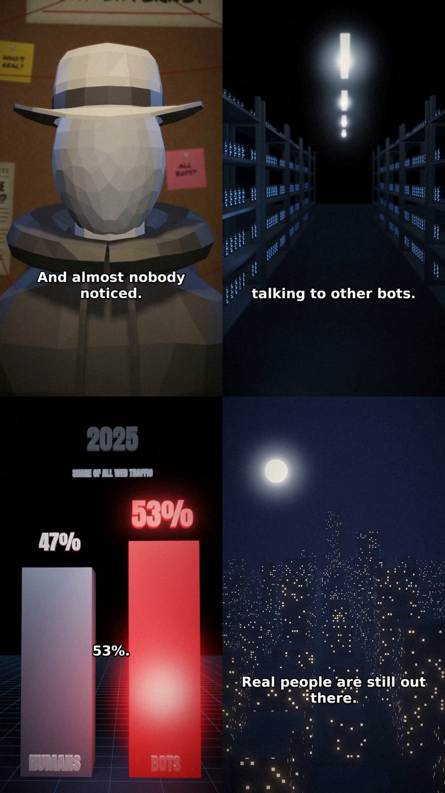

# lowpoly-gl

A small OpenGL 3.3 renderer for flat-shaded low-poly 3D scenes that runs headless on a CPU (moderngl over EGL, on Mesa's llvmpipe), at about 1 s a frame for 1080×1920 including the post pass on a 2-core cloud session. On the same machine and a simpler scene, Blender 5.3 EEVEE took 41 s a frame, Cycles 44 s, and Blender 4.0 EEVEE Legacy 7–12 s. It has:
- **Shading:** forward shading with up to 8 point, spot and directional lights, hemisphere ambient, Blinn-Phong specular, light wrap, and exponential height fog.
- **Shadows:** one soft spot-light shadow map, 12 rotated Poisson PCF taps on a 2048² depth map.
- **Materials:** a colour per vertex, an albedo or emissive texture with a scrolling UV window (`uvx`), and five procedural modes: building windows (lit at night, dark glass by day, any window size), cork speckle, an 8-cell phone-screen atlas that cycles or holds a cell, a glowing floor grid, and unlit vertex colour (for smooth sky gradients).
- **Additive pass:** light-beam cones, glow sprites and dust motes. It writes neither the depth buffer nor the depth stored in alpha.
- **Dynamic meshes:** `set_dynamic()` rewrites a mesh each frame, for red strings, dust or an exploding head.
- **Post (`post.py`):**
  - depth of field from the depth in alpha, made at half size; the background blur ignores the in-focus foreground, so there are no halos around a sharp subject
  - bloom, ACES tone map, a teal-shadow/warm-highlight grade, vignette, cached film grain, an RGB-split glitch, and fades
- **Meshes (`meshkit.py`):**
  - numpy shapes: box, plane, loft, superellipse ring, cylinder, UV sphere, tube, jitter
  - bpy helpers: Decimate for irregular low-poly facets, and 3D text from any font file
  - export to the renderer's triangle soup with flat normals (`.npz`)



**Used in:** The Dead Internet Theory, Area 51 and Birds Aren't Real (Story Time with Kenji, Nov 2026; `../../kids-songs/dead-internet-theory`, `../../kids-songs/area-51`, `../../kids-songs/birds-arent-real`).
- **Scope:** every frame of the 67.4 s Short (2,021 frames at 1080×1920, 30 fps) came from this renderer, in 31 min (0.93 s a frame, post pass included).
- **Verified:**
  - `demo.py` runs from this folder without Blender, in 0.38 s render + 0.19 s post at 540×960
  - two of the Dead Internet scenes, rendered again from the repo, came out byte-identical to the delivered scene files (before the depth-mask fix below)
  - Area 51 and Birds Aren't Real were rendered entirely with the current version
- **Preview:** four frames from the episode: the hooded man, the phone farm, the bar chart and the city.

## Files
- `glr.py`:
  - `Renderer(w, h, msaa=4, shadow=2048)` with `add_meshes(parts)`, `add_texture(name, rgb_uint8)`, `set_dynamic(name, part)` and `render(items, cam, lights, env, adds)`
  - `render` returns float RGBA: linear colour in RGB and view depth in metres in A
  - Matrix helpers: `perspective`, `look_at`, `T`, `R3`, `S`, `euler` (XYZ, radians)
- `post.py`: `finish(img, cfg, frame)` returns uint8 RGB. Also `dof`, `bloom`, `aces`, `glitch`.
- `meshkit.py`:
  - shape class `M`: `.moved`, `.scaled`, `.rotated`, `.tris`
  - shapes: `box`, `plane` (with UVs), `loft`, `ring`, `cyl`, `uvsphere`, `tube`, `join`, `jitter`
  - bpy: `decimate(m, ratio)`, `text_mesh(s, font, size)`
  - export: `add(name, m, colour, pivot)`, `save(path)`, `load(path)`
- `demo.py`: a faceted sphere, a crate, a lamp beam, a glowing screen and a soft shadow, rendered to `out/demo.png`.
- `style.json`: render and post defaults, the light and material keys, and the timings.

## Reuse
```bash
pip install moderngl numpy opencv-python-headless pillow     # plus bpy==5.3.0 only for decimate() and text_mesh()
python3 demo.py                     # out/demo.png at 540x960
RES=1080x1920 python3 demo.py
```
```python
import sys; sys.path.insert(0, 'props/shared/lowpoly-gl')
import numpy as np, meshkit, post
from glr import Renderer
r = Renderer(1080, 1920)
r.add_meshes(meshkit.load('build/assets.npz'))            # parts made with meshkit.add(...) + meshkit.save(...)
img = r.render([('ball', np.eye(4), dict(spec=0.2))],    # (mesh, 4x4 model matrix, material)
               dict(eye=(0, -3, 1.2), target=(0, 0, 0.6), fov=40),
               [dict(type='spot', pos=(0, -0.5, 2.4), dir=(0, 0.2, -1), col=(1, .8, .5), energy=2, outer=40, shadow=True)],
               dict(amb_top=(.01, .012, .02), amb_bot=(.003, .003, .004), fog_col=(0, 0, 0), fog_d=0.05))
frame = post.finish(img, dict(dof=4, focus=3.0, exposure=1.1, bloom=0.4, vignette=0.55, grain=0.022))
```
- **Material keys:**
  - texture: `tex`, `tmode` (1 albedo, 2 emissive, 3 cut-out), `temit`, `uvx` = (u offset, v offset, u scale, v scale)
  - colour: `emit`, `tint`, `spec`, `shin`
  - procedural: `mode` (1 windows, 2 cork, 3 screen atlas, 4 grid, 5 unlit vertex colour), with `seed`, `cellf` (atlas cell to hold, -1 cycles), `tt` and `rate`
  - windows (mode 1): `wsc` scales the 0.9×1.1 m window cell, e.g. (2.2, 3.0) for storeys; `wcol` sets the window colour (default: half the wall colour); `temit` lights a random 12% of them
  - `cast=False` keeps a part out of the shadow map
- **Light keys:**
  - `type` (`point`, `spot`, `dir`), `pos`, `dir`, `col`, `energy`, `range`, `outer` / `inner` (spot cone, degrees), `spec`, `wrap`
  - `shadow=True` on one spot light, with `soft`, `sh_fov`, `sh_near`, `sh_far`
- **Additive items** are `(mesh, M, dict(amode, col, int))`, where amode 0 is a beam cone (apex at the origin, opening down -Z to radius 1), 1 a glow quad and 2 dust. The vertex colour scales each vertex, e.g. per-mote brightness.
- **Env keys:** `amb_top`, `amb_bot`, `fog_col`, `fog_d` (per metre), `fog_h` (height where fog starts thinning), `bg`.

## Gotchas
- **Dropped uniforms:** a uniform the GLSL compiler optimises out is skipped by `_set`, so a material key that never reaches the shader fails silently. In the Dead Internet episode the phone-screen keys (`cellf`, `tt`, `rate`) weren't being set at first, and every phone showed cell 0.
- **MSAA is almost free here:** on llvmpipe, 1, 2 and 4 samples all rendered the episode's hook frame in 0.47–0.58 s. The time goes to fragment shading and the float readback.
- **One shadow:** only the first light with `shadow=True` casts shadows, from a perspective spot map. `sh_fov` must cover every caster; a very wide one (the episode's 106° lamp) gives softer, blockier shadows far away.
- **Flat shading** comes from per-triangle normals, which `meshkit.add` writes. Shared vertices would shade smooth.
- **Depth of field:** the foreground isn't masked, so objects nearer than the focus blur with background colour bleeding into them. Keep big blur for the background.
- **Glitch above about 0.5 hides the subject.** The episode used 0.42 at the peak.
- **Depth writes in the additive pass (fixed Nov 28, 2026):** moderngl 5.13's `Context` has no `depth_mask`, so `c.depth_mask = False` did nothing and every sprite wrote depth. A sprite drawn first then hid the sprites behind it; in Area 51 the switched-off lamp glow cut a black square out of the tractor beam. The mask is now set on the framebuffer. Re-rendered Dead Internet frames change only where dust motes sat behind the lamp's beam cone: 0.7% of the hook frame's pixels; the `who` and `city` frames tested were identical.
- **Textures** are uploaded as sRGB uint8 and turned linear in the shader with a 2.2 power. Emissive textures use `temit` as their brightness.
- **EGL:** `create_standalone_context(backend='egl')` needs Mesa's EGL (`libegl1`, `libgl1-mesa-dri`). There is no GPU in the cloud sessions; on a Mac, moderngl uses the GPU and is far faster.

## What it can't do
- No reflections, refraction, global illumination or screen-space AO.
- One shadowed light; at most 8 lights; transparency only as additive light.
- No skinning: characters are rigid parts on pivots (see `../../kids-songs/hooded-man`).

## Dependencies (tested)
- Python 3.13.18, moderngl 5.13.0 on Mesa 25.2.8 llvmpipe (EGL, OpenGL 4.5 core), numpy 2.5.3, opencv-python-headless 5.0.0.93, pillow 12.3.0
- bpy 5.3.0, only for `meshkit.decimate` and `meshkit.text_mesh`
