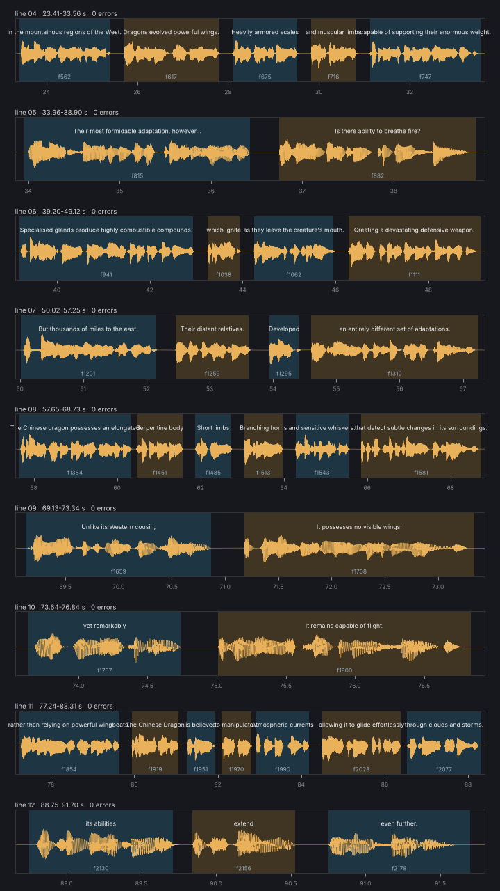

# narration-check

Checks a narration track against its script with offline speech recognition, and finds where every phrase falls so you can cut picture to the words. It uses Whisper small.en (int8) through sherpa-onnx, on the CPU, with no network once the model is downloaded.
- **`words`:** transcribes each line and compares it word for word with the script. It prints the word errors, what was heard and the speaking rate, and exits 1 if any line is wrong. It takes one long track plus a timeline, or a folder of `line_XX.wav` files.
- **`phrases`:** splits each line at its pauses, transcribes every phrase and writes `phrases.json` with start and end in seconds and frames. These are the cut points.
- **`say`:** transcribes a file or a stretch of one.



The preview shows lines 4–12 of "The Two Dragons", each phrase shaded with its first frame and what was heard. It was drawn from `check.py phrases` output from this folder. One phrase in line 5 is misheard ("Is there ability…" for "Is their ability…") although the whole line checks clean: see Gotchas.

**Used in:** The Two Dragons (Wildlore, Nov 2026).
- It caught Kokoro swallowing first words at 1.34× speed, which led to the "... " prefix in the episode's `narrate.py`. It also caught "mist-covered" read as one smeared word.
- It checked all 24 lines at normal speed: 0 errors in 328 words.
- The episode's re-timed edit was cut from its phrase list.

Re-run from this folder before committing:
- **Model:** `get_models.py` streamed the release archive and kept the three files, and all three hashes matched.
- **`words`:** on the episode's narration, 0 errors in 328 words. A script with one word changed was flagged on that line, and the run exited 1.
- **`phrases`:** gave the same 87 phrases, with identical times and transcripts, as the list the episode was edited from.
- **`say`** and the folder mode (`line_XX.wav`) ran.

## Files
- `check.py`, the CLI. The settings at the top can be overridden with flags:
  - `PAD`: 0.05 s around each line
  - `SIL_DB`: −45 dBFS, the 10 ms windows below this count as silence
  - `MIN_PAUSE`: 0.12 s, the shortest silence that splits a phrase
  - `norm()` makes the script and the transcript comparable: lowercase, digits to words, British and American spellings matched, punctuation and hyphens dropped
- `asr.py`: `transcribe(path, t0=None, t1=None)`.
  - Resamples to 16 kHz, adds 0.5 s of silence on each side, and decodes in 28 s chunks.
  - Settings: `WHISPER_DIR` and `ASR_THREADS` (default 2).
- `get_models.py`: streams `sherpa-onnx-whisper-small.en.tar.bz2` (636 MB) from the k2-fsa/sherpa-onnx GitHub release "asr-models".
  - It keeps only the int8 encoder, int8 decoder and tokens (375 MB) in `models/whisper-small.en/` and checks their SHA-256.
  - `--check` only reports.
- `style.json`: model, thresholds and the episode's numbers.
- `preview.png`: the phrase timeline above.

## Reuse
```bash
pip install sherpa-onnx soundfile scipy
python get_models.py                                         # once, ~2 min; or set WHISPER_DIR
python check.py words  script.txt build/vo/vo_raw.wav --timeline build/vo/timeline.json
python check.py words  script.txt ../../animal-docs/wildlore-narrator/out      # wildlore-narrator's line_XX.wav files
python check.py phrases build/vo/vo_raw.wav --timeline build/vo/timeline.json --fps 24 --out build/vo/phrases.json
python check.py say    build/vo/vo_raw.wav 23.4 33.6
```
- **Inputs:**
  - `script.txt`: one line per row.
  - `timeline.json`: `{"lines": [{"start": s, "end": s}, ...]}`, one entry per line, in seconds. `../../animal-docs/two-dragons-episode/narrate.py` writes this, and a bare list also works.
- **Output:** `words` prints one row per line:
  ```
  05  4.94 s  134 wpm  errs=0
  01  3.16 s  133 wpm  errs=1   heard: The Western Dragon and the Chinese Dragon
  ```
- **Cutting to the words:** cut just before a phrase's `f0`, or in the pause before it. In the episode, cuts sat 2–5 frames ahead of the word.

## Gotchas
- **Check words on whole lines, not phrases.** A phrase heard alone loses context: "Is their ability to breathe fire" came back as "Is there ability…" though the full line was transcribed correctly. Use `phrases` for timing only.
- **Spelling:** Whisper writes American spellings and digits. `norm()` applies the same rewriting to both sides, so "armoured", "specialised" and "One" in the script match "armored", "specialized" and "1." from Whisper.
- **Lead-ins:** Kokoro could drop the first word at higher speeds. Prefixing the text with "... " fixed it, and the trim removes the pause it adds. Check every new voice or speed with `words`.
- **Rate:** the `wpm` column counts words over each line's own duration. Wildlore lines read at 94–170 wpm, about 124 overall. Long scientific words make it look slower than it sounds.
- **Speed:** about 5 s of compute per narration line on 2 cores. The 87-phrase split of a 2:53 track takes about a minute.
- **Sandboxes:** some Claude sandboxes swap in rewritten copies of the ONNX files and print a note saying so. Results are the same.

## What it can't do
- English only: small.en is an English model.
- No forced alignment or word-level timestamps. Phrase boundaries come from pauses, so words joined without a pause share one span.
- It can't judge delivery: tone, emphasis and mispronounced names that still decode to the right word pass.

## Dependencies (tested)
- Python 3.13: sherpa-onnx 2.0.2, onnxruntime 1.29.0, soundfile 0.14.0, scipy 1.18.1, numpy 2.5.3
- Whisper small.en int8 ONNX (MIT, k2-fsa/sherpa-onnx release "asr-models"), downloaded by `get_models.py`
