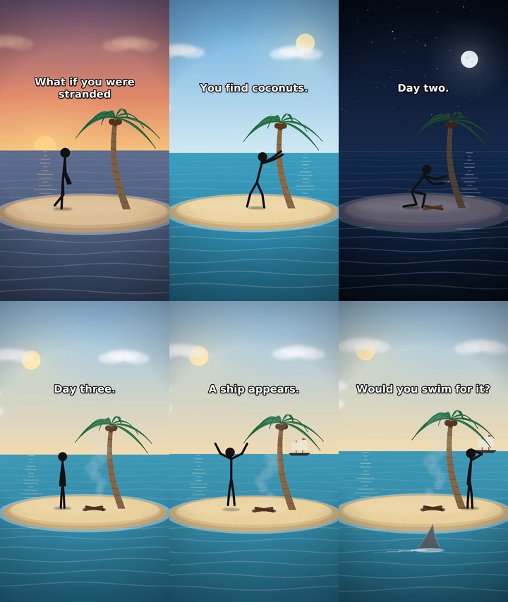

# stickman-style

A bare black stick figure in a detailed, painted-looking island world, told as a "what if" survival Short: "What if you were stranded on a tiny island?", in five scenes and 14.47 s. It uses the Story Time narrator with one caption per line, drawn with skia-python at 1080×1920 and 30 fps.



The preview shows one frame from each part:
- dawn arrival
- coconuts by day
- the fire at night
- day three
- the ship on the horizon
- the shark fin under "Would you swim for it?"

**Used in:** the style tests for a new Shorts channel (Nov 2026). This was the stickman option next to the bean look in `../cartoon-shorts`, which also has a stick-figure look (`--style stick`).
- `build/stickman_demo.mp4`: 14.47 s, 9 captioned lines, 5 scenes.
- Re-run from a fresh clone before committing: `python build.py --stills`, then the full `python build.py` (23 s). The video and audio matched the earlier render exactly.

## Files
- `stickman.py`: the figure and the world.
  - `stick(c, x, ground, s, pose, ...)` with the poses `stand`, `walk(p)`, `shrug`, `push(t)`, `crouch(t)`, `wave(t)`, `salute`
  - `sky`, `sea`, `island`, `palm`, `campfire`, `ship`, `fin` and `coconut`, in four times of day (`settings.TOD`: dawn, day, night, morning)
- `build.py`: the five scenes, the soundtrack and the encode.
  - Soundtrack: the Story Time music preset, ocean, crackle, crickets, a ship's horn and a riser.
  - `--stills` and `--frames` for checks.
- `settings.py`: the figure's proportions, the horizon and island, the time-of-day palettes, the story lines and the mix.

## Reuse
```bash
./setup.sh cartoon-shorts     # from the repo root: the kids-songs set this demo needs
cd shared/stickman-style
python build.py               # -> build/stickman_demo.mp4 (1080x1920, 30 fps, AAC 192k)
python build.py --stills      # build/stills.png, one frame per scene
python build.py --frames 3,9.5
```
**A new "what if" story:**
1. Change `STORY` in `settings.py`: a scene name and one caption line per row.
2. Add a draw function per new scene in `build.py`, built from `stickman.py`'s pieces.

## Gotchas
- **The hook card is off.** `build.py` turns off the Story Time kit's hook card, so the first caption is the hook.
- **Captions sit in the sky** (`CAP_Y = 560`), so keep the sky clear behind them.
- **A cut lands on a dip from black.** At each cut the picture dips from black for 0.2 s (the kit's `SCENE_FADE_IN`), so a frame grabbed exactly at a cut is black.
- **The narration comes from `../../kids-songs/storytime-narrator`.** Its model must be there: set `KOKORO_DIR`, or run its `get_models.py`.

## What it can't do
- The figure has no face and no clothes. For faces, clothes and props, use `../cartoon-shorts` (the stick look, or the what-if look in `cast.py`).
- It has one world (the island). A new place means new draw functions.
- There's no speech check here: run `../narration-check/check.py` on `build/narration.wav`.

## Dependencies (tested)
- **Python and packages:** Python 3.13.18, skia-python 144.1, numpy 2.5.3, scipy 1.18.1, soundfile 0.14.0, kokoro-onnx 0.6.1.
- **Tools:** ffmpeg 6.1.1.
- **Sibling props:** `../../kids-songs/storytime-kit`, `storytime-narrator` (Kokoro v1.0 int8) and `storytime-music`.
